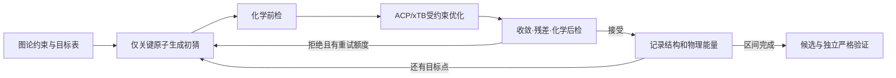

# Classic：图论驱动、关键原子预测与 xTB 原生受约束扫描

> 状态：设计完成；实现与真实验收待执行，生产默认未改变
> 层级：G1→G2；G2-AB3；工作流 C/R/X
> 取代关系：细化 ADR-0010/0011 的 Classic 物理底座；本批选择 ACP/xTB 原生扫描路线，承接 ADR-0006 的控制/优化分离；保留旧算法与历史证据
> 上游依赖：[开发宪法](../PES2TS_开发宪法_v1.md)、[阶段定义](../plans/PES2TS_阶段定义_G0-G3.md)、[三模块架构](PES2TS_三模块与可视化产品架构_v1_20261005.md)、[ADR-0012](decisions/ADR-0012-Classic图论驱动与xTB原生约束扫描.md)
> 下游消费者：[AB3 整合实施方案](../plans/PES2TS_G2_AB3功能整合与原生扫描改造方案_20261006.md)、ACP 对接、Classic 执行/候选/成本、未来 PES-N 状态采集
> 当前版本：v1 @ 2026-10-06；接口名为待实施草案，尚非已发布 schema

## 1. 决策和范围

用户要求的主流程落实为：**端点化学图编译约束 → 只主动移动关键成断键原子生成下一点初猜 → ACP 调用 xTB 原生受约束几何优化 → 检查真实结构 → 接受后继续推进扫描 → 提取候选并进入独立严格验证。**

本设计采用 `relax_environment`：PES2TS 的初猜只改关键原子，xTB 松弛其余未固定原子，也可调整关键原子未被约束的自由度。这符合宪法 §5.3。另设计 `freeze_environment` 选项：在 ACP/xTB 中精确固定非关键原子的 Cartesian 坐标；它是不同物理探索协议，单独验收和报告，不自动成为默认。两个模式均会计算完整体系的电子结构；减少主动移动原子不等于只计算这些原子的能量/梯度。

“扫描完全”在首版定义为**冻结的低维反应坐标区间及规定加密点均获得合格结构**。一条协同路径是多坐标共享一个参数的 1D 扫描；它不覆盖完整的高维势能面，也不证明得到 MEP、唯一通道或 TS。二维网格、替代构象和不同事件顺序属于显式扩展实验。

本轮交付设计与实施方案，没有改运行算法、启动 QC、提高预算或切换默认。规范仍由宪法 v2.1 提供；G2 科学出口仍是 24 个可审计终态以及至少一例非参考严格目标 TS。

## 2. 为什么改，哪些能力已经存在

当前 G2.T AB2 的 24 例终态为 3 `complete_path`、19 `partial_prefix`、2 `rejected_typed`、0 `validated`。19 个前缀中，13 个总预算耗尽，2 个局部预算耗尽，2 个局部停滞，2 个旁观键几何异常。S4 仍受人工化学复核门约束。工程收口与目标 TS 验证是不同结果。

当前 Classic 由 `continuation.py` 推进，再由 `local_corrector.py` 在全 Cartesian 空间做投影/BFGS/回溯，反复通过 `gradient_backend.py` 获取 ACP/ORCA 的 GFN2-xTB 梯度。现有真实局部尝试的梯度调用中位数为 64，费用主要来自这些重复 QC 评估和跨层往返。新方案把局部几何响应交给 xTB 内部优化器；PES2TS 保留化学目标和跨扫描点的决策。

源码检查范围：PES2TS HEAD `124df245c3562b230ebb98fe91ab94cde5ef5d14` 加当前未提交修改；ACP 检查位置为 `E:/Calculations/Common_Script/Auto_Calc_Platform/ACP_V1_20260811`，HEAD `2a23b938592ee6d23f18cb62e189ff21a1a150b0`。这是源码定位证据，不能替代真实能力冒烟。

| 可复用能力 | 当前落点 | 本批处置 |
|---|---|---|
| 映射、端点图、F/B 编辑、事件耦合 | `g1/endpoint_graph.py`、`reaction_edit_graph.py`、`bond_changes.py`、`event_coupling.py` | 保留图/事件实现；新增统一化学控制编译门面 |
| 起点选边、坐标池、范围与配方冻结 | `generation/planning/connectivity_plan.py`、`coordinate_pool.py`、`schedules.py`、`plan_freeze.py` | 复用并显式记录方向；新运行只用合法端点/图论输入 |
| 初猜投影及坐标几何 | `continuation.py`、`synchronized_path.py`、`geometry_feasibility.py` | 复用坐标值/Jacobian等纯数学工具；新增关键原子受限初猜器 |
| 化学质量与身份 | `planning/structure_checks.py`、`ts_checks.py`；`integration/acp/quality.py` | 统一规则门面；区分计算产物完整性和化学质量 |
| 战役、恢复、预算、记录 | `generation/campaign.py`、`planning/cost_capture.py`、`integration/acp/frame_recovery.py` | 复用外层生命周期，新增明确算法分支与原生收据 |
| 执行协议及 ACP 传输 | `generation/execution/protocol.py`、`integration/acp/` | 保留现有方法；新增版本化 native scan 请求/结果适配 |
| 候选、路径、严格验证 | `planning/candidate_selection.py`、`ranking/`、`integration/acp/stage_cli.py`、`stage_results.py` | 新增能量扫描候选分支，复用 hash 绑定和验证链 |
| 旧全原子 BFGS | `local_corrector.py`、`gradient_backend.py`、旧 continuation 配方 | 显式 `classic_legacy_projected_bfgs` 对照；新路线不暗中回落 |

ACP 底层已存在 `cccp/qc/interfaces/xtb.py::constrained_optimize/relaxed_scan`、`acp/backends/xtb.py` 封装和 `acp/calculations/primitives/scan.py` 基元。但存在三个接入缺口：

1. 当前约束优化以 `coordinates is not None` 判 success；没有可靠携带进程退出、SCC/几何收敛与失败标记。生成了 `xtbopt.xyz` 不足以接受该点。
2. 当前批量扫描的回调只是通知，异常被吞后继续；下一点直接使用引擎判成功的结构，无法等待 PES2TS 化学接受。因此首版选择逐点请求 ACP 原生约束优化；批量路径留待具有接受握手后再验收。
3. 当前输出主要是 `TOTAL ENERGY` 与结构，物理能量/约束势、真实坐标残差和内部评估费用尚未构成可信统一收据。公开调用入口也要独立确认，不能把底层函数存在当作可用 CLI。

本批前置审计修补另见 [2026-10-06 审核](../../outputs/reviews/G2_real_campaign_review_20261006.md)：曲率探针漏记费用、历史崩溃目录污染当前统计、缺参考误报超越参考。修正报告用新版本，不覆盖 AB2 历史产物。

## 3. 按功能整合，而非重排仓库

沿用受保护目录，新增薄门面；先让 CLI/控制器消费同一规则与记录，再考虑移除确认无调用的旧分支。G0/G1/G2 是开发阶段，不是三个运行时服务。

| 产品功能 | 单一责任 | 拟新增/扩展代码落点 |
|---|---|---|
| 拓扑约束 | 编译 H、原子角色、driver/guard/monitor/target_test；执行前合法性和执行后化学检查 | `planning/chemical_control.py`、`quality/chemical_rules.py`；调用现有 G1 与几何检查 |
| Classic 控制器 | 选择目标值、关键原子初猜、接受/拒绝、有限重试、区间覆盖、候选档案 | `planning/active_predictor.py`、`planning/classic_scan.py`；`campaign.py` 仅管外层批次 |
| 计算器接缝 | 将结构/目标/协议映射到 ACP；验收收据、索引、单位及产物摘要 | `integration/acp/xtb_constraints_request.py`、`xtb_constraints_transport.py`、`native_constraint_results.py`；`execution/native_relaxed_scan.py` 包装为统一轨迹 |
| 候选/验证与展示 | 能量候选及其资格；统一记录的展示投影；严格验证复用既有链 | `planning/candidate_selection.py` 新方法分派、`campaign_report.py` 新版本报告、现有 viewer/验证适配 |

依赖方向：拓扑纯规则不依赖控制器、模型或 QC 进程；控制器调用规则与 execution 接口；execution 调用 ACP 适配器；适配器只处理计算证据，不自行定义目标反应。真实进程、资源、取消与缓存执行继续由 ACP 拥有，按宪法 R3/P4。

初期仅把公共数学函数移到或导出自轻量纯工具位置，避免新扫描器反向依赖整个旧 continuation 生命周期。迁移实现时保留旧 import 包装与回归，禁止一次性搬动所有目录。`generation/quality/` 目前仅有包入口，新增门面先委托原函数，逐项去重，避免两套同名规则各自演进。

## 4. 化学控制合同与关键原子

### 4.1 输入和支持范围

首批生产资格仍限定已支持的、完整 R/P 原子映射及完全成断键 F/B 事件；图不能从目标 TS/IRC 真值构造。部分事件/坐标探索可由同门面表达，但其执行和目标验证资格单独开放，缺 P 不补写完整目标。

`ChemicalControlSpec` 草案至少包含：输入/图 hash、固定原子顺序与 map 表、元素/同位素、电荷/多重度、事件及方向、坐标角色、范围/单位/来源、关键原子集合 K、可选固定集、质量规则版本、目标身份完整度、能力需求、预算和协议 hash。含未知的信息保留未知及原因。

### 4.2 活动集合 K

默认 `K = 所有本阶段 F/B driver 所涉及原子的并集`，包括实际转移的 H 和断键原子，不能只选最终“成键”的重原子。K 不自动扩大到整个反应中心一跳邻域。几何支持原子可参与 guard/monitor 并在 xTB 中松弛；若某模板要由它们参与主动预测，则该模板有明确支持集与新策略版本，当前首版范围先不自动放行。

元素和 map 身份不等于数组位置。PES2TS 内部保持确定的 0-based 数组位置，ACP/xTB 序号在适配器按 frozen atom-order 表转换为 1-based；禁止 `map_id - 1`。转换双向可核验，并绑定 `atom_order_sha256/map_hash`。

### 4.3 图约束不是冻结每一条键

- `driver`：本点必须推进的事件距离；首版多个 driver 同步推进，全部传给 ACP，不降成单键。
- `guard`：保护必要的非事件连接、H 伙伴、立体/碰撞边界；先作为独立后验条件。确需势约束的 guard 显式标注后端可编译类型和容差，不把一般不等式伪装成 xTB 等式势。
- `monitor`：只观察，不能被适配器偷偷写成约束。
- `target_test`：在规定端点检查目标化学；原子数/身份/电子态贯穿全程。

F/B 键在中间区间允许过渡，不能用“每帧完全等同 R 图”拒绝目标变化。非事件键保护、事件容许区间和终点完整身份各用对应判据；距离阈值/键级证据有不确定区域时记录 needs_review/拒绝原因。连续键级不当作严格离散拓扑证明。

## 5. 每一个扫描点怎样运行



图中的重试从最后已接受结构和细分目标重新生成，拒绝结构不作为父帧。前检失败或重试额度耗尽时留存拒绝/前缀终态。

### 5.1 起点、方向和目标网格

起点准备仍经 ACP，记录自由优化或必要预约束的真实协议及费用。起点若拓扑/电子态不合格，终止为 typed 输入/准备拒绝；不能通过优化把输入问题隐藏。

方向记录为 `R_to_P` 或 `P_to_R`。复用现有起点选择器时，按选中的一端生成执行目标，最终展示按 canonical R→P 归一；不假定所有 formed 在执行时都缩短。对已成键终端距离，可用合法端点几何；离解片段距离只作显式范围规则，不能把任意片段摆放当唯一化学目标。

首版采用冻结的 `lambda_grid`，令 `q_i(lambda) = q_i,start + lambda*(q_i,end-q_i,start)`；也允许来源可追溯的自定义值表。21/41 点可作为 train/calibration 比较候选，不直接成为生产默认。冻结 grid、最大间隔、峰区加密规则、坐标容差、力常数、优化级别、最大循环及总预算。分段/序贯事件只有在原先机理允许且配方登记后启用。

### 5.2 稀疏初猜：只做几何，不做能量最小化

从上一个**已接受**的真实结构 X 出发，计算目标差 `dq = q_target - q(X)`。对 driver Jacobian 仅保留 K 的 Cartesian 列：`J_K`。解带尺度的最小位移线性问题：

```text
min ||W^(1/2) delta_X_K||²
subject to J_K delta_X_K = dq
delta_X_not_K = 0
```

采用尺度化 SVD/伪逆，质量或模板权重 W 显式记录。条件是局部坐标可微、K 内 Jacobian 具有所需秩、当前步足够小；秩不足、共线退化或目标不相容返回 typed 状态。加阻尼时记录这是近似解，不宣称严格投影。

一个 seed 可进行有限次纯几何修正，以满足 seed 级残差和逐原子位移上限；每次只写 K 行。环体系/耦合位移不可实现时减小推进或拒绝，不悄悄动其余原子。第一点与初始端点相同无需多余预测。

输出记录 `active_atom_ids`、`delta_X_K`、各目标/实际初猜坐标、残差与可实现性。数值不变量：所有非 K 原子初猜坐标与父结构逐值相同；全体系刚体对齐仅用于诊断副本，不对初猜施加会移动非 K 原子的全局变换。初猜器没有能量/梯度调用，没有 BFGS 或全原子 Hessian 更新。

### 5.3 交给 ACP/xTB 的实际运算

每个本点请求携带 seed、原子身份、电子态、GFN 方法/溶剂、driver 目标、编译后的必要势约束、可选固定集及冻结优化协议。ACP 执行**一个 xTB 原生受约束优化任务**，由 xTB 内部完成多轮能量/梯度/几何更新，并提供最终收据与产物。PES2TS 不把每一轮优化再拆成 ACP 梯度请求。

首版只保证复用上一接受几何，不假定跨任务复用优化器Hessian或SCC检查点。以后若ACP提供检查点复用，另核验电子态/方法/目标/版本兼容、父摘要及其失败回退，再作独立消融。

xTB 原生默认 ANCopt 使用近似正常坐标、模型 Hessian 和内部更新。改造收益来自优化器/坐标处理及减少宿主往返的可能改善；内部仍需完整体系的梯度，也可能不收敛。不能预先承诺“一点一次梯度”或固定倍数加速。[xTB 优化文档](https://xtb-docs.readthedocs.io/en/latest/optimization.html)

xTB 的距离/角度约束通常通过有限强度势实现，实际坐标可能偏离目标。`freeze_environment` 则需要 `$fix` 的精确 Cartesian 固定，不能用 `$constrain atoms` 代替。力常数与单位、优化级别、约束写法针对所用二进制版本做能力测试，不照搬 ORCA `%geom` 或假定每坐标力常数写法有效。[扫描文档](https://xtb-docs.readthedocs.io/en/latest/scan.html)、[固定与约束文档](https://xtb-docs.readthedocs.io/en/latest/xcontrol.html)

### 5.4 收据、验收与推进

按顺序检查：

1. **计算身份**：request/attempt/result/geometry/atom-order/method hash 与当前点一致，最终结构来自本次唯一 attempt；拒绝陈旧输出。
2. **计算终态**：可靠进程退出、SCC 收敛、优化收敛的原始证据；失败标记（如对应版本的 `NOT_CONVERGED`）与最大循环到达优先解释。证据缺失记 unknown，不能由 output XYZ 推导 success。
3. **数值和约束**：完整有限坐标，实际 `q(X_final)`，逐坐标单位和残差；固定模式检查实际固定行。目标 lambda 不能冒充实际扫描位置。
4. **化学与连续性**：非目标拓扑变化、H 伙伴、碰撞、立体、相邻帧结构/坐标跳变、事件范围及电子态。规则版本和全部理由落盘。
5. **观测资格与费用**：能量通道、梯度来源/缺失、真实费用和预算余额；接受帧拥有其原始收据及检查记录。

只有通过本点检查的结构才成为下一点父结构。拒绝结构保留为尝试证据，不能推进状态。软约束下收敛的是带势的目标，不要求原始无约束梯度全零，也不能据此称为物理驻点或沿用旧 `physical` 标签；新 evidence 类型暂定 `native_relaxed_restraints`，与原始 E/g 的测量来源分开。

### 5.5 重试和停止

首版仅开放预注册的有限步长细分：同一合格父帧到下一目标间插入中点，再尝试原目标。最多细分层数/额外点/本点重试均冻结；例如两层细分可作为校准候选，不作为隐式默认。缩步不保证消除软约束残差，仍失败即停。

未登记的新力常数、自由度解冻、改变电子态、随意追加优化循环或切换旧 BFGS 不属于相同策略的“恢复”；它们要成为不同 recipe/attempt，或明确不支持。超时、费用耗尽、不可实现、未收敛和质量拒绝均保留原因和费用，禁止不断加预算。

扫描结果分三轴：

- `execution_terminal`：计算/控制流程是否结束，有无阻塞。
- `coverage`：请求点数、已接受点数、区间、实际坐标范围、未覆盖点；`scan_interval_complete` 仅表示计划范围完成。
- `chemical_validation`：终点身份与 TS 验证分别记录；完整扫描不等于 `validated`。

分支跳变时保留现有前缀；另一方向/构象分支使用新 execution/plan。批量原生 `$scan` 可作为后续速度路线，但要能在化学拒绝后停止或避免用拒绝帧生成后续接受轨迹，不能只依赖通知回调。xTB 多坐标 concerted scan 仍是一条 1D 参数曲线，多维网格需另作有限规划。[扫描模式文档](https://xtb-docs.readthedocs.io/en/latest/scan.html)

## 6. 能量、候选与严格验证

xTB 总能量包含额外约束势项。约束强度/残差变化可制造表观峰，因此不把直接解析的 `TOTAL ENERGY` 当未加势的物理曲线。[xTB 能量定义](https://xtb-docs.readthedocs.io/en/latest/sp.html)

本批将 `E_effective`、`E_restraint`、`E_physical` 分通道记录，全部带 geometry/method hash、单位和原始来源。只有在版本化解析与真实对照证明能正确分离时，才用 `E_effective - E_restraint`；否则每个已接受点由 ACP 做同几何、同方法/电子态/溶剂、**无额外约束势的单点能**取得 `E_physical`，计入预算。这个单点不再优化结构；此观测是受约束结构上的物理能量，不证明结构驻定。

首版规则选取物理能量曲线上被两侧合格帧夹住的峰及必要邻帧，去重后按冻结 top-k 送往严格验证；无峰时返回明确状态。前缀边界候选可单列 `edge_unbracketed` 并按预算验证，不能称已夹住峰。`candidate_selection.py` 现有路径依赖梯度证据，故新增独立能量选点方法及新版本 proposal 旁车，不填零梯度来复用旧排序。原 ranking 的纯能量规则可复用算法，但几何/协议绑定重新检验。

仅在候选诊断或验证准备确有用途时追加物理梯度；缺梯度时 ReactiveState 的对应 observation mask=false。内优化器的梯度 norm、加势梯度、原始物理梯度、投影自由梯度区分来源与定义，互不替代。无条件启用每帧曲率探针/Hessian 不属于首版。

`SeedProposal → preparation/OptTS → Freq/目标模式 → 双向 IRC → 端点优化/完整身份 → ValidationResult` 沿用现有链。移除扫描约束的准备动作显式记录；若自由优化掉回极小值，记录失败/费用，不能当成扫描成功。验证资格与人工复核门继续按既有输入/证据协议执行。

## 7. 待实施接口与兼容

以下是 ADR-0012 登记的具体草案；实现时冻结字段、schema、validator、fixture和能力证据。旧七对象及 `g2_path_v1`、GenerationPlanV2、旧战役 manifest/报告不原地改义。

| 草案接口 | 核心字段/检查 | 连接方式 |
|---|---|---|
| `pes2ts_chemical_control_spec_v1` | H/图/顺序 hash，K/fixed/角色，方向，范围来源，规则/协议/资格 | 已登记 ChemicalControlSpec 族的首版具体草案 |
| `pes2ts_native_scan_plan_v1` | 明确 `classic_native_xtb_scan`、control hash、完整目标表、种子/后端策略、能力与预算 | 新方法计划；不塞入旧 v2 未登记 discriminator |
| `pes2ts_native_constraint_request_v1` | 父 accepted-frame/seed hash、target 含单位、fix、method、电荷自旋、优化配置、idempotency digest | PES2TS→ACP 协商映射，实际公开入口待 WP-1 确认 |
| `pes2ts_native_constraint_outcome_v1` | 终态/收敛证据/原因、几何产品及 hash、真实目标值、能量通道、观测来源、receipt/费用 | ACP 结果归一层，计算成功与化学接受分开 |
| `pes2ts_native_scan_trace_v1` | 每个目标和尝试的父子身份、pre/post rule decisions、接受/拒绝、费用、覆盖、候选 | Action/Transition/DecisionTrace 族的 Classic 数据来源 |
| `pes2ts_native_scan_seed_proposals_v1` | rule/峰夹逼资格、energy channel、geometry/path/plan hash、完整度、验证状态 | energy-only 候选，适配既有 SeedProposal 主对象并挂旁车 |

新算法配置显式声明 `engine_mode=classic_native_xtb_scan`；旧模式可读且可明确重跑。CLI 不因名称继续叫 classic 而改变旧默认。实现/fixture 后先以选择开关验收；真实试点、24例报告和严格验证达到发布门后才提生产默认变更。新算法失败不能静默调用旧算法；显式 fallback 有独立尝试与费用。

新输出使用独立不可变根、manifest 和 protocol hash；新 sidecar 绑定父内容 hash。统一 `TrajectoryRecord/PathBundle` 中的 physical energy 缺失保留 null，不能写 effective energy 冒充。旧读者可忽略新旁车；新读者按版本分派，不推测来源。完成区间、化学接受与原 terminal 投影的映射在新报告版本说明，不重标 AB2。

未来 PES-N 可以复用化学规则、低维 target action 和同一 ACP optimizer，但其状态带方法/策略/收敛与观测掩码；原生扫描不是与旧 BFGS 完全同分布的转移。已记录的 Classic 失败/费用可用于有资格的离线数据；旧/新轨迹不无条件混成一套动力学教师。冻结模型和严格验证标签仍按宪法 R1/R6 隔离。

## 8. 费用、恢复与速度评估

每点一个 host 原生优化请求不等于一个 QC energy/gradient 评估。费用统计按原生收据分别记录内部 `N_energy/N_gradient/N_Hessian`、额外物理单点、严格验证、重试/失败、缓存复用以及实际 wall/CPU/分配核时。没有内部计数时保存 `null + reason`；按优化步数推估的计数只作估计列，不能混入实测总数。模型 Hessian 构造不等于实际量化 Hessian 调用。

整体预算包括起点、拒绝点、补充观测与验证的约定范围。优化单点的 ACP 超时设置不超过控制器剩余 wall 额度；超时后由 ACP 取消/收口，未确认终态的作业不盲目再投。回收已完成但宿主尚未落盘的 receipt 后重做纯规则判定，再推进状态。

wall、最大目标/尝试数及原生循环上限作为首版可执行预算。若原生内部没有实时计数/中断能力，则梯度次数或实测CPU硬上限标为不可强制，不能沿用旧计数预算声称受控；需要这类硬上限的运行先等待ACP计量/取消能力。优化循环上限和host请求数各是自己的计数，不冒充梯度次数。

缓存键至少绑定输入几何/顺序/电子态、目标、固定集、方法/溶剂、优化/约束协议与操作。不同 target 或 fix 集不可共享结果；同 id/key 异 hash 为显式冲突。attempt 和原生优化中间结构完整留存，重复回收不重复计费。

预期费用模型：

```text
旧路径 = 起点 + Σ(外层局部尝试的多次独立梯度/回溯) + 探针/验证
新路径 = 起点 + Σ(每点 xTB 内部优化 + 必要的无势单点) + 重试/验证
```

收益是假设而非结论。GFN2 名称相同不证明 ORCA 接口与直接 xTB 二进制完全等价，软势扫描也不同于旧精确投影。主对照比较用户关心的端到端配方；若要归因“只改优化器”，另做同后端/物理协议的受控消融，披露实现、溶剂、SCC和几何阈值差异。

在 train/calibration 内选多 driver、完整路径、停滞、旁观键异常等分层 4 例冻结试点，再全量24例评估；参数选择不使用 family holdout。新旧每例输入、资源、总预算及严格验证协议一致，记录所有分母，不能只比较完成路径。速度目标可预注册为 wall 中位数至少降低50%，它是开发目标，验收仍看覆盖/质量/严格候选及费用，不为了达到速度目标放宽化学门。

## 9. 实现和验收顺序

实施步骤、文件和依赖详见 [AB3 方案](../plans/PES2TS_G2_AB3功能整合与原生扫描改造方案_20261006.md)。顺序为审计修补 → ACP 收敛/能量/费用/公开入口 → 规则整合与关键原子初猜 → 原生逐点控制器 → 兼容候选/报告 → 离线门 → 4例真实试点 → 冻结24例 → 有资格的严格验证。

首版可以通过以下事实验收：非K初猜不变；所有driver传递；映射/单位正确；未收敛输出不被接受；拒绝帧不进入下一点；实际坐标残差可追溯；物理/加势能量分离；每份收据与费用对账；恢复不重复计算；旧读者/配方可用；新旧对照不隐藏失败；科学出口仍由严格目标验证确认。

当前能力表达：本设计 `design_complete`；新增 PES2TS 原生扫描器与正式 schema `not_implemented`；ACP 底层实现存在但本集成能力 `unknown`，待真实验收。旧 AB2 收口、已存在实现与科学结果保持历史记录，不能因设计完成标成 `smoke_passed`。
