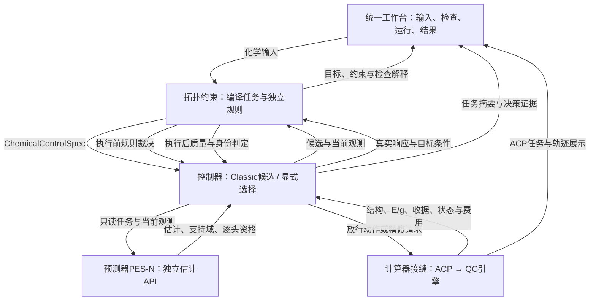

# PES2TS 三模块与可视化产品架构 v1.1（预测器所有权细化）

> 状态：当前产品架构设计；逻辑边界与规划生效，统一模块、弱先验入口、产品界面及模型能力尚待实现与分项验收
> 层级：G1 化学控制 / G2 控制与执行整合 / G3–G4 模型接入；工作流 C / R / X
> 取代关系：细化 ADR-0010 的宿主架构及 ACP 展示接缝；不取代工程阶段、旧接口、历史证据与发布门
> 上游依赖：[开发宪法](../PES2TS_开发宪法_v1.md)、[阶段定义](../plans/PES2TS_阶段定义_G0-G3.md)、[ADR-0010](decisions/ADR-0010-PES-N反应状态价值与STOP-MOVE统一决策.md)、[ADR-0011](decisions/ADR-0011-三模块产品架构与统一可视化.md)
> 下游消费者：G1/G2 整合工作包、PES-N 接入、ACP 适配与展示、产品接口和用户验收
> 当前版本：v1.1 @ 2026-10-07（ADR-0014：运行视图内预测器独立代码归属）
> 范围：架构、交互、组件复用与验收设计；未迁移目录、修改业务代码/配置、启动计算或训练

## 1. 产品定义

PES2TS 面向用户提供一个工作台：输入化学转化或探索设想，查看编译后的目标与控制范围，在预算内执行搜索或评价已有候选，并检查严格验证证据及全部费用。

内部采用三个逻辑模块：拓扑约束、控制器、计算器；可视化层横向连接输入、决策与结果。统一数据合同、记录及版本是跨模块基础，不另设一个与三模块竞争的科学决策层。

三模块是职责及公共入口的整合视图，不要求立即形成三个目录、三个仓库、三个服务或三个独立安装包。G0–G4 仍表示开发与验收阶段，不表示运行时模块。

按[ADR-0014](decisions/ADR-0014-预测器产品归属与G3代码范围.md)，代码所有权细分拓扑、预测器PES-N、宿主控制器和ACP计算器接缝。运行视图里的控制器“调用预测器”不表示两者共享任意业务代码；预测器有独立pesn根，离线开发也属于该产品。文件/API/测试范围见[预测器模块设计](PES2TS_预测器产品与G3代码模块划分_v1_20261007.md)。

## 2. 架构与运行闭环

该图表示运行调用关系；模块通过合同交换数据，拓扑规则实现不依赖控制器或模型。控制器保存上一接受状态，调用独立规则检查候选，执行后再依据真实质量判定接受或拒绝。拒绝响应仍保留产物和费用；合格响应成为下一次决策的观测。

STOP 从当前或合格历史帧进入冻结精修协议。低成本帧切换 DFT 时的 preparation、OptTS、Freq、双向 IRC、端点优化由计算器经 ACP 执行；端点和目标模态的化学判定属于拓扑规则与 PES2TS 验证侧。严格终态留在结果/隔离标签侧；首版预定多 seed 序列不由其验证结论重规划当前生成。相应边界见宪法 R1/R2/R6、§8。

## 3. 三模块责任

| 模块 | 核心问题 | 接收 | 产出 | 实现归属 |
|---|---|---|---|---|
| 拓扑约束 | 允许探索什么；怎样判断响应是否符合声明的化学条件 | 化学输入、结构身份、当前状态、候选/计算结果 | ChemicalControlSpec、执行前裁决、执行后质量与身份判定 | PES2TS 化学层；复用 G1 和 G2 的化学检查 |
| 预测器（独立代码归属） | 当前状态/候选的预测量是什么 | 只读任务、当前观测、特征/模型与能力合同 | 教师研究预测或已验收DecisionEstimate；支持域/资格/版本 | PES-N产品pesn；offline隔离数据/训练/模型评测 |
| 控制器 | 下一笔预算花在哪里 | 控制合同、真实观测、预算、规则裁决、预测器估计 | Classic候选、选中动作、DecisionTrace、父子状态与费用绑定 | PES2TS宿主；调用预测器与独立Shield，拥有显式选择 |
| 计算器 | 请求的物理计算实际发生了什么 | 放行的坐标目标/计算操作、方法、几何、资源与身份 | ACP收据、结构/E/g、数值收敛、执行状态、原始产品与计时 | PES2TS只提供ACP接缝；调度/引擎/资源由ACP拥有 |

拓扑模块提供规则定义和确定性检查服务；控制器调用服务并决定是否接受状态，模型不能覆盖规则裁决。风险分层和模型不确定性影响候选与决策，但不替代化学检查。生产 backup 的真实执行同样走计算器接缝。

计算器既可执行单步约束优化，也可执行已验收的整条 PATH/scan 等宏观选项。模块视图不意味着所有历史轨迹都能拆成与 MOVE 相容的学习转移。能力可用性以实际 capability 和收据为依据，而非只凭方法字符串。

## 4. 统一输入：完整目标与弱先验

用户入口采用三种填写方式，输出统一到版本化 ChemicalControlSpec。

| 输入方式 | 用户提供 | 标准化重点 | 目标评价边界 |
|---|---|---|---|
| 完整反应 | 映射R/P、结构、电子态及必要化学条件 | 原子/事件对齐、目标图、角色和允许控制 | 满足协议与模型支持条件时可评价目标STOP |
| 部分事件 | 当前/R结构、明确事件、可选P及保护条件 | 区分已知、待检验、未知；显式端点身份判据 | 能形成充分目标判据且该条件已验收时才开放目标STOP |
| 坐标设想 | 当前结构、选定原子、拉伸/压缩/角度范围及预算 | 将探索建议与目标事件分开；验证引用、单位与可执行性 | 目标不充分时只开放已验收探索能力，目标p_seed/Q_STOP不可用 |

示例：输入“同时拉长 A–B 和 C–D”可编译为两个距离driver及变化范围，不自动编译为“两键必断”“产物已知”或“其余所有键冻结”。用户可补充事件与身份条件并形成新版本；运行绑定此前冻结版本。输入确认不替代既有流程要求的化学复核记录。

合同内容按已有接口族细化：原子/图身份，必须/允许/禁止/未知条件，化学角色与硬约束支持集，driver/monitor/guard/target_test，坐标单位/尺度/范围，相位及回退条件，电子态，目标判据及可用性，来源/复核/规则版本。具体字段、弱先验分支的schema和fixture另行登记；不把空P伪造为已通过旧ReactionCase合同的输入。

多种输入统一格式是目标能力。弱先验、多事件、O编辑、电子态及坐标类型分别接受能力检查；已有F/B放行范围不因新界面而扩大。

## 5. 控制器：同一循环，逐步扩展策略

| 策略配置 | 使用方式 | 对用户的解释 |
|---|---|---|
| Classic | 已验收规则产生候选和选择动作，拓扑规则检查，ACP实际执行 | 当前规则基线及可用backup |
| STOP辅助 | 同协议候选池上的p_seed/C_full/Q_STOP；在通过相应接入门后用于选点 | 评价哪些已有帧值得精修；未学习MOVE-Q时不比较继续搜索价值 |
| 价值导航 | 保留Classic候选，加有界残差/缩步；比较STOP、MOVE、已验收FALLBACK | 同预算、同失败处理下选择下一操作 |

PES-N是控制器调用的独立预测器，运行内核不获得执行、调度或化学目标所有权。G3.P可先IRC教师预训练，正式决策接入仍先STOP监督，后真实动作模仿/残差、保守离线Q与冻结模型真实闭环；初始化/迁移按ADR-0013对照验收。接口输出availability、支持域和校准版本；缺少的Q不填0。

预算状态、候选档案和历史由宿主控制器保存；QC作业进程、取消与调度由ACP保存。Classic预算终止规则、候选顺序等冻结配方不会因接入STOP显示而隐式变化；新决策策略单独验收。

## 6. 可视化：一个入口，四个用户步骤

建议先在ACP现有Workbench中形成PES2TS化学视图及标准展示投影。ACP原生任务/帧展示和任务操作由ACP提供；PES2TS提供化学约束、决策与身份检查的数据及语义。具体前端接缝在ACP能力核验后确定，本设计不宣称现有Workbench已支持全部页面。

| 步骤 | 用户看到 | 用户能做 |
|---|---|---|
| 输入 | 完整反应、部分事件、坐标设想入口；分子与稳定原子编号 | 导入结构，选择原子/键，填写事件、电子态、预算 |
| 检查 | 成断键/角色叠加、硬条件/建议/未知区别、可用能力及缺失项 | 修改设想、查看编译解释、保存新版本并确认运行方案 |
| 运行 | ACP任务状态、接受帧、q/同方法能量曲线、已发生费用、最新动作与原因 | 查看轨迹和日志；通过ACP已有任务能力暂停/取消/恢复（仅已支持者） |
| 结果 | 候选结构、预测值、严格验证证据、端点身份、全部尝试与费用 | 对比候选，提交已支持精修请求，导出科学结果及可回放记录 |

同一视图支持“发起搜索”和“评价已有状态/轨迹”。只评价已有合格观测不触发QC；补算或精修显示具体操作与预算后由宿主提交。用户输入只有XYZ时先显示缺失观测，不假装已取得E/g。

选择曲线点联动结构、坐标、来源、决策和验证证据；能量曲线按同一方法通道呈现，不直接跨组成/方法拼接绝对能量。单点预测与已执行结果分别标识，未支持的模型输出显示“当前版本不支持”。

主结果状态分别显示：任务执行状态、路径/状态质量、目标符合性、严格验证状态。路径完整、能量峰、单虚频与模型高分均不能触发“已验证目标TS”标记，判据引用宪法R2。探索目标尚未定义时显示“目标尚未定义”；不是目标失败，也不是已验证成功。

结果页可展示本次真实验证产物，在线输入页与模型请求没有从结果页自动取用未来证据的通道。参考TS/IRC数据只在隔离的离线训练/评测视图中按审计访问器读取，见宪法R1/R6；统一外观不合并其数据权限。

首版交互验收：用户能确认所选原子与规则；辨认当前值/预测值/缺失值；查到一次拒绝或失败及费用；联动查看候选和证据；导出的结果与底层身份一致。恢复展示从已落盘记录与ACP状态重建，缓存的运行状态显示采集时间。

## 7. 已有组件复用与实际缺口

以下为源文件与接口定位，不是逐项真实能力升级结论。

| 逻辑模块 | 可复用入口 | 整合缺口 |
|---|---|---|
| 拓扑图/事件 | `g1/endpoint_graph.py`、`reaction_edit_graph.py`、`event_coupling.py` | 多输入适配、统一合同、弱先验语义与资格 |
| 坐标与化学规则 | `generation/planning/coordinate_pool.py`、`connectivity_plan.py`、`geometry_feasibility.py`、`structure_checks.py`、`target_path.py` | 将分散检查收口到独立规则服务，绑定规则版本；不复制原判断 |
| Classic控制 | `planning/selector.py`、`plan_freeze.py`、`continuation.py`、`candidate_selection.py`、`generation/campaign.py` | 单步/宏观选项的一致调用与trace，原生优化接入；预算与回放保持一致 |
| 计算器接缝 | `generation/execution/protocol.py`、`execution/xtb_path/acp_backend.py`、`integration/acp/` | capability核验、原生约束优化及全部精修操作的真实收据 |
| 验证与成本 | `integration/validation.py`、`integration/acp/stage_results.py`、`planning/cost_capture.py`、`flywheel.py` | preparation、模态、端点身份等严格证据；计时单位与测量来源审计 |
| 展示 | ACP注册接线与现有报告/轨迹记录；参见ACP执行统一方案§13.3 | 化学输入编辑、trace投影、结果联动及Workbench真实展示验收 |
| 预测器 | 已登记未来`pes2ts_core/pesn/`；目前目录不存在 | G3-P1的在线API/特征/模型与offline来源/标签/分裂/训练/模型评测/导出；后续STOP/残差/Q和宿主接入另验收 |

现有G1/G2提供实质复用基础，但模块统一、弱输入与严格闭环并未由源文件存在而完成。既有本地校正原型保留为历史基线；未来生产几何响应采用ACP原生优化方向，见ADR-0006/0010。

## 8. 数据与接口的极简整合

对用户，数据归于一个反应任务及其版本、运行与结果；这个聚合视图不另建第二套真值或任务数据库。

跨模块复用ADR-0010合同族：ChemicalControlSpec表达化学条件；ReactiveState表达当前观测；Action/Transition表达命令与真实响应；DecisionEstimate/ShieldDecision/DecisionTrace表达估计和裁决；SeedProtocol/SeedOutcome表达精修尝试与结局。UI消费同一记录的展示投影，不自己推断科学成功。

旧链`ReactionCase → GenerationPlanV2 → TrajectoryRecord → PathBundle → SeedProposal → ValidationResult`继续可读。新字段用已登记接口族的版本化旁车绑定父hash；外部帧保留自己的来源，不伪造内部执行记录。成本绑定attempt/receipt并去重，`cpu_seconds`等历史字段先核对计时来源，wall时间不直接当作实测CPU核时；缺失保持原因。

离线数据按State、StopAttempt、Transition三类关联视图组织：多源状态可标注STOP；已知命令且相容环境才用于MOVE。IRC邻帧和响应位移不自动成为动作。训练/标签构建留在隔离侧，模型冻结后供控制器使用，不把训练流水线放入运行闭环。

## 9. 极简实现与依赖

首轮通过薄门面和适配器整合现有实现，保留受保护目录；不以模块数量要求重写图算法、优化器、任务调度、报告器或渲染器。逻辑依赖为：合同被三模块共享；控制器依赖拓扑规则、可选PES-N和ACP接缝；拓扑规则不依赖模型/QC；ACP接缝不拥有化学决策；UI调用相同应用入口。

预测器的runtime只依赖自身输入合同/特征/模型/运行资产及纯公共工具；它不import拓扑编译器、控制器、QC或自己的offline。图/坐标authority在offline adapter转换为普通数据；offline来源/标签/训练/模型评测属于预测器，通用严格验证和全系统评测继续留在宿主证据侧。本期开发范围以G3-P1 §7/模块设计为准，产品配套配置/依赖/测试和单点guard登记不承载业务算法。

沿用`plan / generate / rank / validate / report`的语义，并让UI和命令入口使用同一应用门面。公共方法与新schema签名在实现工作包中登记；本设计没有创建新的生产API。具体前端库、部署服务数量及目录迁移后置于实际依赖审计，避免为接口整合建立通用插件框架。

## 10. 分期落地与验收

| 归属 | 工作 | 出口证据 |
|---|---|---|
| G1/G2 C/X | 完整输入适配、ChemicalControlSpec和规则门面、Classic与ACP统一记录；完成当前战役收口 | 原子重排/单位/冲突/旧链兼容fixture；现有配方回放；相应真实能力收据 |
| G2 X | 现有真实产物的只读可视化，先结果浏览再输入与执行入口 | Workbench真实任务展示；候选/曲线/证据联动；失败与费用完整 |
| G1/G2 R/X | 部分事件和坐标设想入口，原生优化与严格验证补齐 | 弱目标不冒充完整目标；电子态/坐标/作用范围分项验收；G2出口继续按阶段定义 |
| G3.P / G3-P1 | 预测器唯一业务根pesn；在线集/offline隔离，B0–B6文件/接口/测试交付 | 不等G2调教；scope/import/export与教师科研门，研究包不接管控制器 |
| G3.0/G3.1 | 隔离STOP数据/原型准备；冻结协议补标签；接入单点STOP评价 | p/C/Q、校准、固定池同预算严格收益；训练可提前准备，模型接入另验收 |
| G3.2/G4 | 残差候选、相容转移离线Q、冻结模型真实闭环 | Classic/BC对照、动作支持与风险、成功率门下总费用收益 |

最小产品首先是已有Classic能力的统一输入、ACP执行和证据展示，能够诚实呈现未运行、部分路径、拒绝与验证缺口。它可在没有学习权重时使用；完整严格TS能力仍由G2物理证据决定。此后只扩展控制器的已支持策略，用户无需学习一套新的产品操作。

本次交付是架构及文档同步。上述schema、薄门面、前端、权重和真实能力尚未在本轮实现或验收；当前计算、默认策略和历史结果保持原记录。

2026-10-07 v1.1按ADR-0014细化预测器产品责任、调用关系和G3-P1代码范围；运行三模块视图/用户工作台保持，源目录和代码尚未迁移/修改。
